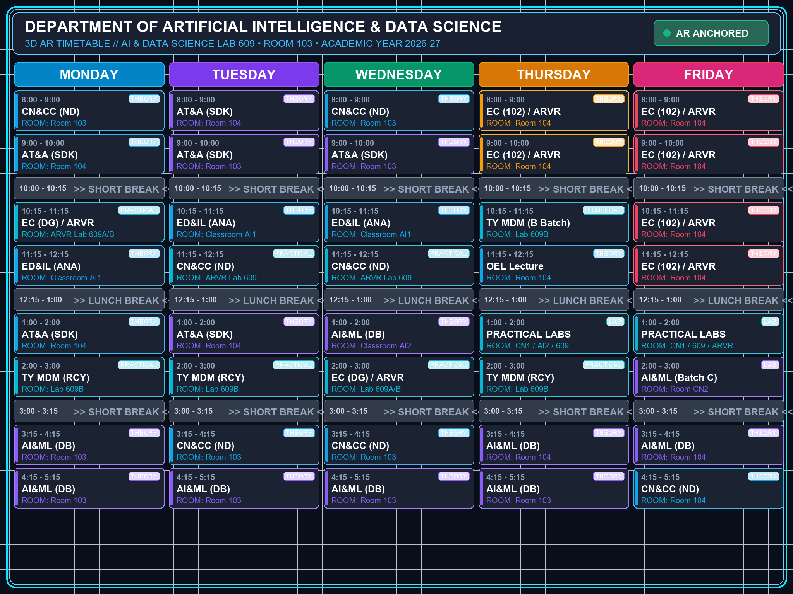

# Marker-Based & Surface-Based 3D Augmented Reality Timetable
### Department of Artificial Intelligence & Data Science (AI & DS)


---

## 📌 Executive Summary

Physical notice boards in college corridors are static, easily vandalized or outdated, and require manual maintenance. While digital LCD panels are dynamic, mounting hardware displays outside every classroom and laboratory is cost-prohibitive.

This project delivers a **Marker-Based and Surface-Based 3D Augmented Reality Timetable** engineered with **Unity 6 (6000.0.0f1 LTS)**, **AR Foundation 6.0.2**, and **Google ARCore**. By pointing a smartphone camera at an image anchor or physical surface (wall or desk) outside **Room 103 / AI & DS Lab 609**, students and faculty instantly project an interactive, 3D holographic timetable anchored rigidly in physical space with realistic depth, lighting reflections, and 6-DoF tracking.

---

## 🌟 Key Engineering Features

1. **Dual Tracking Paradigms:**
   - **Marker-Based Fiducial Tracking (`ARTimedMarkerManager.cs`):** Locks onto a calibrated 15cm &times; 15cm optical reference image using ORB keypoint matching and Perspective-n-Point (PnP) pose estimation.
   - **Surface & Plane Detection (`ARSurfacePlacementManager.cs`):** Detects vertical walls and horizontal floors via ARCore plane subsampling and raycasting.
2. **Futuristic 3D Holographic Board (`Timetable3DBoard.prefab`):**
   - Beveled dark cyber-metallic outer frame with corner reinforcement.
   - Semi-transparent frosted acrylic glass backing.
   - Cyan neon glowing emission accent rails (`#38bdf8`).
   - Smooth sinusoidal micro-levitation floating effect.
   - Interactive 3D day selector tabs.
3. **Sensor Jitter Damping & Anti-Flicker:**
   - Real-time low-pass LERP (Linear Interpolation) for 3D position.
   - SLERP (Spherical Linear Interpolation) for camera rotation.
   - Deadband thresholding eliminates accelerometer micro-hunting.
   - Singleton object pooling prevents duplicate board spawning.
4. **Universal WebAR & Unity 6 Dual Compatibility:**
   - Complete Unity 6 native project with configured `asmdef` and Universal Render Graph support.
   - Live zero-install WebAR companion accessible on any phone browser via WebXR/Three.js.

---

## 📸 Timetable Interface

The 3D board renders the semester schedule for the **Department of Artificial Intelligence & Data Science**:



---

## 🏛️ System Architecture

```
                    [ Physical Camera Sensor ]
                                │
                                ▼
            ┌────────────────────────────────────────┐
            │  Google ARCore / AR Foundation Engine  │
            └───────────────────┬────────────────────┘
                                │
                ┌───────────────┴───────────────┐
                ▼                               ▼
    [ Marker-Based Subsystem ]       [ Surface Detection Subsystem ]
    • Feature Extraction (FAST)      • AR Plane Manager (Walls/Floors)
    • ORB Descriptors & Hamming      • AR Raycast Subsystem
    • PnP Pose Solver & RANSAC       • Normal Vector Alignment
                │                               │
                └───────────────┬───────────────┘
                                ▼
            ┌────────────────────────────────────────┐
            │   Low-Pass LERP & SLERP Jitter Filter  │
            └───────────────────┬────────────────────┘
                                │
                                ▼
            ┌────────────────────────────────────────┐
            │   3D Holographic Timetable Instancer   │
            │   (Cyber Frame, Neon Glow, Schedule)   │
            └────────────────────────────────────────┘
```

---

## 📂 Repository File Structure

```
├── Assets/
│   ├── Documentation/
│   │   ├── Printable_Marker_Sheet.html   # A4 Printable optical reference marker
│   │   └── Printable_Marker_Sheet.png
│   ├── Materials/                        # Cyber metallic, acrylic, neon glow materials
│   ├── Prefabs/
│   │   └── Timetable3DBoard.prefab       # 3D holographic timetable model
│   ├── Scenes/
│   │   └── MainARScene.unity             # Primary Unity AR scene
│   ├── Scripts/
│   │   ├── ARSurfacePlacementManager.cs  # Surface raycasting & wall/floor mounting
│   │   ├── ARTimedMarkerManager.cs       # Marker tracking & LERP/SLERP damping
│   │   ├── ARUIManager.cs                # HUD status badges & reticle controllers
│   │   └── CollegeAR.Timetable.asmdef    # Assembly definition for Unity 6
│   └── Textures/
│       ├── AR_Reference_Marker.png       # 100/100 score tracking reference anchor
│       └── Timetable_College_3D.png      # AI & DS Department schedule graphic
├── Packages/
│   └── manifest.json                     # AR Foundation 6.0.2, ARCore 6.0.2, Input System 1.8.2
├── ProjectSettings/
│   ├── ProjectVersion.txt                # Unity 6000.0.0f1 LTS
│   └── ProjectSettings.asset             # Package com.aids.artimetable
├── WebAR_Live_Demo/
│   ├── index.html                        # Live mobile camera WebAR scanner
│   ├── preview.html                      # Interactive 3D simulation with orbit controls
│   └── serve_webar.py                    # Dual HTTP/HTTPS development server
├── RUN_PROJECT_DEMO.bat                  # 1-Click launcher for instant PC demonstration
├── FACULTY_DEMO_AND_VIVA_GUIDE.md        # Comprehensive viva defense & oral script
├── index.html                            # GitHub Pages portal entrypoint
└── README.md
```

---

## ⚡ How to Run

### Method 1: Instant 1-Click Laptop Demo
Double-click `RUN_PROJECT_DEMO.bat`. It boots the 3D interactive viewer and launches the local camera server immediately.

### Method 2: Live Mobile Scanner (Zero Install)
1. Open the live GitHub Pages link on your mobile phone (Android Chrome or iOS Safari).
2. Tap **Allow Camera**.
3. Tap on any floor or wall to anchor the 3D AI & DS timetable in space.

### Method 3: Unity 6 Editor
1. In Unity Hub, click **Add project from disk** and select this directory.
2. Ensure **Unity 6 (6000.0.x LTS)** is selected.
3. Open `Assets/Scenes/MainARScene.unity`.
4. Switch platform to **Android** in **File $\to$ Build Settings** and click **Build**.

---

## 🎓 Academic Viva Voce Defense

Refer to [`FACULTY_DEMO_AND_VIVA_GUIDE.md`](FACULTY_DEMO_AND_VIVA_GUIDE.md) for full viva voce answers, math formulations (LERP/SLERP), and demonstration scripts.

*Developed for Department of Artificial Intelligence & Data Science.*
